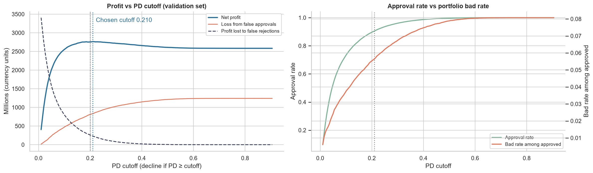
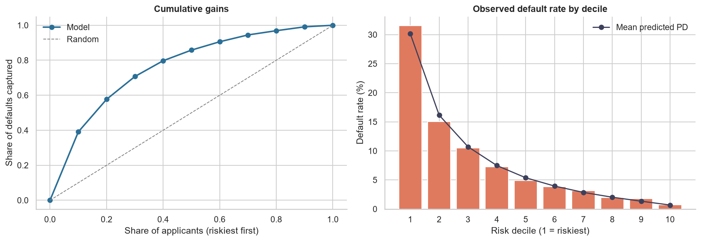
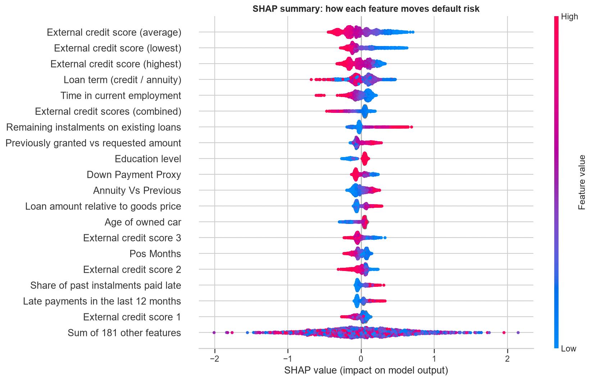
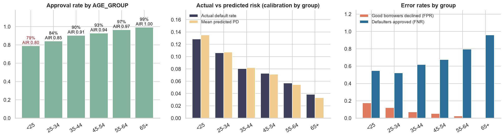

# Credit Risk Scoring & Loan Default Prediction

An end-to-end credit risk project that turns loan applications and 58M rows of credit history into a **calibrated probability of default (PD)**, a **cost-optimised lending decision** (approve / refer / decline), **explainable reason codes**, a **fairness audit**, an **interactive Streamlit app** and a **public Tableau dashboard**.

**Live interactive dashboard (Tableau Public):** [Credit Risk Scoring & Loan Default Prediction](https://public.tableau.com/app/profile/avneet.saini3393/viz/CreditRiskScoringLoanDefaultPrediction/Lendingdecisions)

Built on the [Home Credit Default Risk](https://www.kaggle.com/competitions/home-credit-default-risk) dataset (307,511 applications, 8 relational tables).

> **Disclaimer:** an educational portfolio project. It is not a production credit-decisioning system and must not be used for real lending decisions.

---

## 1. Business problem

Home Credit lends to people with little or no credit history. Every lending decision trades off two errors:

| Error | Business cost |
|---|---|
| **False approval**: lend to someone who defaults | Lose ~LGD × loan amount (assumed 60%) |
| **False rejection**: decline someone who would repay | Lose the margin on a good loan (assumed 15%) and the customer |

**Goal:** rank applicants by default risk, estimate a *calibrated* PD, and choose a decision policy that maximises risk-adjusted profit while staying explainable and fair.

`TARGET = 1` means the client had **payment difficulties**: a payment more than X days late on at least one of the first Y instalments.

## 2. Solution overview

```
Raw tables (8 CSVs, ~2.5 GB)
   │  Stage 2-4: load, SQL analysis, clean (anomalies, types, validation)
   ▼
Feature store (1 row / applicant, 200 selected features)
   │  Stage 6: bureau history, payment delays, utilisation, refusals, affordability ratios
   ▼
Model pipeline (sklearn ColumnTransformer + LightGBM / XGBoost / LR / RF)
   │  Stage 7-9: train/valid/test, class weights, early stopping, Platt calibration
   ▼
Calibrated PD ──► Expected loss = PD × LGD × EAD
   │  Stage 10: profit-maximising cutoff + refer band + risk grades A-E
   ▼
Decision + reason codes (SHAP) + fairness monitoring ──► Streamlit dashboard
```

## 3. Repository structure

```
credit-risk-scoring/
├── config/config.yaml            # paths, split sizes, business assumptions, fairness settings
├── data/{raw,interim,processed}  # raw Kaggle CSVs (not committed) → cleaned → features
├── database/                     # SQLite database built in stage 3
├── sql/                          # 01_create_views.sql, 02_analysis_queries.sql (19 named queries)
├── notebooks/                    # 13 stage notebooks, run in order
├── src/credit_risk/              # reusable package used by notebooks AND the app
│   ├── data_loader.py            # loading, memory optimisation, data dictionary, relationships
│   ├── database.py               # SQLite build (chunked) + named-query runner
│   ├── cleaning.py               # anomaly codes, impossible values, data-quality reports
│   ├── features.py               # application, bureau, previous, instalment, POS, card features
│   ├── preprocessing.py          # split, feature selection, linear/tree pipelines, winsoriser
│   ├── modeling.py               # model zoo, early stopping, CreditRiskModel (calibrated PD)
│   ├── evaluation.py             # metrics (AUC, Gini, KS, PR-AUC…), decile tables, plots
│   ├── thresholds.py             # cost-sensitive sweep, decision policy, risk grades
│   ├── explainability.py         # SHAP, global importance, reason codes
│   └── fairness.py               # Fairlearn MetricFrame reports, adverse impact ratio
├── app/streamlit_app.py          # dashboard
├── models/                       # fitted models, feature contract, decision policy (not committed)
├── reports/                      # figures, metrics, SQL results, data dictionary, tableau/ dashboard files
├── scripts/                      # download_data.py, make_sample_data.py, run_notebooks.py
└── tests/                        # pytest unit tests
```

## 4. Quick start (Anaconda)


```bash
# 1. Environment
conda env create -f environment.yml
conda activate credit-risk
python -m ipykernel install --user --name credit-risk --display-name "Python (credit-risk)"

# 2. Data: needs a Kaggle API token in ~/.kaggle/kaggle.json and the competition rules accepted
python scripts/download_data.py            # or unzip the Kaggle download into data/raw/

# 3. Run the stages, interactively...
jupyter lab                                # open notebooks/01_project_setup.ipynb and run 01 → 13
# ...or headless
python scripts/run_notebooks.py --inplace

# 4. Dashboard
streamlit run app/streamlit_app.py

# 5. Tests
pytest
```

**Hardware:** 16 GB RAM recommended for the full data (8 GB works with `SAMPLE_ROWS` set in notebook 02 and `sql.skip_tables: [bureau_balance]`). The whole pipeline runs in roughly 30–60 minutes on a modern laptop; the SQLite build and feature engineering are the slowest steps.

**No data yet? Smoke-test everything in ~2 minutes** on a synthetic dataset with the same schema:
```bash
python scripts/make_sample_data.py --out data/sample
CREDIT_RISK_RAW_DIR=data/sample python scripts/run_notebooks.py      # Windows: set CREDIT_RISK_RAW_DIR=data/sample
```
(Synthetic numbers are meaningless. Delete `data/processed`, `models` and `database` before running on the real data.)

## 5. The 13 stages

| # | Notebook | What it does | Key outputs |
|---|---|---|---|
| 1 | `01_project_setup` | Environment, versions, paths, data presence | – |
| 2 | `02_data_loading` | Load 8 tables, memory optimisation, relationships, data dictionary | `reports/data_dictionary.csv` |
| 3 | `03_sql_analysis` | SQLite build, views, 19 business queries (joins, CTEs, `RANK`, `NTILE`, `ROW_NUMBER`, `LAG`, running totals) | `reports/sql/*.csv` |
| 4 | `04_data_cleaning` | Missingness (and whether it predicts default), duplicates, outliers, `365243` anomaly, types, validation rules | cleaned parquet, data-quality report |
| 5 | `05_eda` | Target imbalance, demographics, income/credit, ratios, external scores, correlations, Plotly views | `reports/figures/eda_*` |
| 6 | `06_feature_engineering` | ~100 behavioural features: payment delays, utilisation, bureau history, refusals; leakage audit | `features_train/test.parquet` |
| 7 | `07_preprocessing` | Protected-attribute exclusion, stratified split, train-only feature selection, pipelines, imbalance | `models/feature_lists.json` |
| 8 | `08_modeling` | Logistic Regression, Random Forest, XGBoost, LightGBM; early stopping; calibration; champion selection | `models/*.joblib` |
| 9 | `09_model_evaluation` | Accuracy, precision, recall, F1, specificity, ROC-AUC, PR-AUC, KS, Gini, confusion matrix, calibration, deciles, bootstrap CIs | `reports/test_metrics.json` |
| 10 | `10_threshold_optimization` | Expected-loss framework, profit curve, false approvals vs false rejections, sensitivity to LGD/margin, approve/refer/decline policy | `models/decision_policy.json` |
| 11 | `11_explainability` | SHAP global importance, beeswarm, dependence, waterfall for individual applicants, reason codes | `reports/figures/shap_*` |
| 12 | `12_fairness` | Approval & error rates by gender, age, marital status; adverse impact ratio; proxy test; less-discriminatory-alternative test | `reports/fairness_report.csv` |
| 13 | `13_dashboard_artifacts` | Dashboard data + training-serving consistency test | `data/processed/dashboard_*` |

## 6. Results

All figures below are on the **untouched test set**: 46,127 applicants (15% of the data), 8.07% default rate. The model, cutoff and calibration were all chosen on the separate validation set.

### Model performance

| Model | Test ROC-AUC (95% CI) | Gini | KS | PR-AUC | Brier |
|---|---|---|---|---|---|
| **LightGBM (champion)** | **0.792** (0.785–0.800) | **0.585** | 0.445 | **0.294** | **0.0654** |
| XGBoost | 0.792 (0.783–0.799) | 0.585 | 0.448 | 0.292 | 0.0654 |
| Logistic Regression | 0.778 (0.768–0.786) | 0.556 | 0.421 | 0.270 | 0.0665 |
| Random Forest | 0.770 (0.761–0.777) | 0.539 | 0.411 | 0.255 | 0.0672 |

- **Champion: LightGBM**, selected on validation ROC-AUC (0.790). Its test performance is statistically tied with XGBoost (the confidence intervals overlap almost entirely). It trains in about 60 seconds, against about 150 for XGBoost.
- **Interpretable baseline:** logistic regression is only about 0.014 AUC behind. In a regulated setting it would be a credible alternative champion.
- **Calibrated probabilities:** mean predicted PD 8.07% vs actual default rate 8.07%, so PDs can be used directly for expected-loss and pricing calculations.
- **Risk ranking:** the riskiest 10% of applicants default at 31.5% (3.9× the average) and contain 39% of all defaults. The riskiest 20% contain 58%. The safest 10% default at 0.7%.
- **Accuracy is misleading here:** at a naive 0.50 cutoff every model is about 92% accurate but catches only 3–4% of defaulters. That's why the cutoff is set from business costs instead (below).

### Lending decision policy

Assumptions: loss given default (LGD) 60% and lifetime net margin 15% of the credit amount, which give an analytic break-even PD of 20%.

| Policy (test set) | Approval rate | Bad rate of approved | Credit losses avoided | Net profit vs approving everyone |
|---|---|---|---|---|
| Approve everyone | 100% | 8.07% | – | baseline |
| Model, 0.50 cutoff | 99.6% | 7.85% | 2.7% | +1.1% |
| **Model, profit-optimal cutoff (PD ≥ 21% → decline)** | **90.6%** | **5.57%** | **33.6%** | **+7.5%** |

- The profit-maximising cutoff found on validation data (21%) lands next to the 20% analytic break-even, so the theory and the data agree.
- **Three-way decision:** Approve 83.2% of applicants (actual default rate 4.6%), refer 7.4% to an underwriter (16.7%), and decline 9.4% (32.0%).
- **Risk grades A–E** show observed default rates of 1.8%, 4.2%, 7.6%, 13.2% and 31.1%, each close to its mean predicted PD.
- **Sensitivity:** across LGD 40–90% and margin 8–30%, the optimal cutoff ranges from 9% to 41% (see `reports/threshold_sensitivity.csv`). The policy should be re-derived whenever the loss or pricing assumptions change.

### What drives risk (SHAP)

- **Top drivers:** the external credit scores (average, lowest, highest and combined), the loan term (credit ÷ annuity), time in current employment, remaining instalments on existing loans, how much the client was granted versus requested on past applications, education level, the down payment, and the current annuity relative to past loans.
- **About 42% of the model's total importance comes from credit history** aggregated from the five history tables (bureau 14%, instalment payments 10%, previous applications 9%, POS loans 5%, credit cards 4%).
- **Feature engineering paid off:** 22 of the 25 strongest single predictors were engineered features. The combined external score reaches a univariate AUC of 0.716, against 0.659 for the best raw column.

### Fairness

| Attribute | Lowest adverse impact ratio (AIR) | Notes |
|---|---|---|
| Gender (not a model input) | 0.88 (men vs women) | Men's actual default rate is 10.2% vs 7.0% for women; the model is well calibrated for both |
| Marital status (not a model input) | 0.92 | No group below the 0.80 threshold |
| Age group | **0.80 (under 25)** | Under-25s: 78.9% approval vs 99.3% for 65+. Their actual default rate is 12.8% and they are well calibrated, but creditworthy under-25s are declined more often (false positive rate 17.5% vs 2.4% for 55–64) |

The under-25 group sits right at the four-fifths threshold. Two further tests show why simply leaving a protected attribute out of the model isn't enough:

- **Proxy test:** the model's inputs predict gender with an AUC of **0.90**, mostly through occupation, car age and employer type. Excluding gender doesn't make the model blind to it, which is why outcomes are tested directly.
- **Less-discriminatory-alternative test:** retraining without age features changes test AUC only slightly (0.7923 → 0.7915). But the under-25 AIR gets *worse* (0.80 → 0.75), because correlated features take over age's role less accurately. Keeping age, which is allowed in an empirically derived scoring system as long as older applicants aren't scored down, and monitoring it is the better-supported choice.

### Figures

| | |
|---|---|
|  |  |
|  |  |

### Dashboards

- **Tableau Public (no install needed):** [open the live dashboard](https://public.tableau.com/app/profile/avneet.saini3393/viz/CreditRiskScoringLoanDefaultPrediction/Lendingdecisions). It has two views: *Lending decisions* (KPIs, decision mix, risk grades and an interactive PD-cutoff slider) and *Model and fairness* (SHAP drivers, decile lift, model comparison, segment and fairness analysis). Built from the aggregated files in `reports/tableau/` (`python scripts/export_tableau.py`). No row-level applicant data is published.
- **Streamlit app (run locally):** `streamlit run app/streamlit_app.py` for applicant-level scoring, reason codes, what-if analysis and counter-offers.

<!-- Dashboard screenshots -->

## 7. Key design decisions

1. **Leakage prevention by design.** History is filtered to events before the application date; no aggregation sees `TARGET`; every learned transform (imputation, scaling, encoding, outlier caps, feature selection) is fitted on the training split inside a pipeline; the test split is used once. Notebook 6 audits for future-dated records and flags any single feature with AUC > 0.80.
2. **Calibrated PDs, not scores.** Class weighting inflates probabilities. Platt scaling on the validation set restores a PD that can be multiplied by LGD and EAD.
3. **Thresholds from economics, not 0.5 or F1.** With LGD 60% and margin 15%, the analytic break-even PD is 20%. The empirical profit-maximising cutoff is checked against this, and its sensitivity to both assumptions is shown.
4. **Approve / refer / decline**, not binary. Borderline applicants go to an underwriter, and the app suggests a smaller counter-offer when one would be approved.
5. **One feature function for training and serving** (`assemble_features`), plus an automated training-serving consistency test.
6. **Responsible lending.** Gender and marital status are excluded from the model but kept for outcome testing. Fairness is measured with Fairlearn, proxies are tested, and an age-free alternative model is evaluated. Group-specific thresholds are deliberately not used (that would be disparate treatment).

## 8. Limitations and next steps

- No application dates, so no **out-of-time** validation or vintage analysis. In production, validate on the most recent months and monitor **PSI** for drift.
- **Reject inference:** outcomes exist only for approved loans, so the model never sees how rejected applicants would have behaved.
- LGD and margin are assumptions. A full expected-loss framework would model LGD and EAD separately.
- `EXT_SOURCE_*` are opaque third-party scores, which complicates reason codes.
- Next: Optuna tuning, a WoE/IV logistic **scorecard** with points, MLflow tracking, a FastAPI scoring endpoint, scheduled monitoring.

## 9. Data licence

The data is provided by Home Credit Group through Kaggle under the competition rules. It is **not** included in this repository. Download it yourself after accepting the rules.
